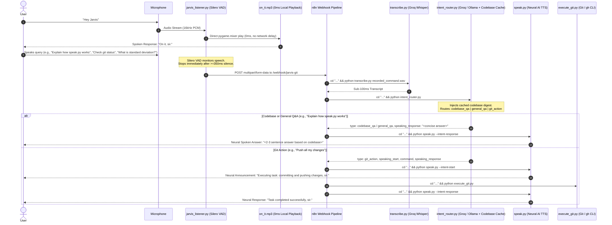

# Jarvis - Real-Time Codebase Assistant & Voice Git Automation

Zero-cost, local, zero-latency voice assistant that handles **Codebase Q&A, Git/GitHub CLI operations, and general conversational AI queries** using **openWakeWord** (Sensitivity: 0.20), **0ms Local Wake Acknowledgment**, **Silero VAD** (350ms silence cutoff), **Groq Whisper (`whisper-large-v3-turbo`)**, **Groq LLM (`llama-3.3-70b-versatile` with cached codebase context)**, **Neural AI TTS (`edge-tts` with `en-US-ChristopherNeural`)**, and **n8n**.

---

## Conversational Voice Architecture



---

## Component Architecture

1. [`jarvis_listener.py`](jarvis_listener.py):
   - **0ms Instant Wake Acknowledgment**: Plays pre-rendered `on_it.mp3` directly via `pygame.mixer` inside the listener process.
   - **Dynamic Silero VAD**: Automatically stops recording within 350ms of trailing silence.
   - **Multipart Webhook Dispatch**: Posts to `http://localhost:5678/webhook/jarvis-git`.
2. [`intent_router.py`](intent_router.py):
   - **Codebase Context Scanner**: Crawls and caches key files (`.py`, `.bat`, `.json`, `.md`) with a 120s TTL cache.
   - **Tri-Mode Classifier**: Distinguishes `codebase_qa` vs `git_action` vs `general_qa`.
   - **Fast Voice Responses**: Enforces `max_tokens: 150` for crisp, natural 2–3 sentence spoken answers.
3. [`speak.py`](speak.py):
   - Pre-rendered static clips: `on_it.mp3` and `listening.mp3`.
   - Pre-warmed 24kHz `pygame.mixer` player for sub-50ms dynamic playback.
   - Reuses single `temp_speech.mp3` cache file.
4. [`execute_git.py`](execute_git.py):
   - Injects GitHub CLI into PATH.
   - Automatically bypasses Git execution for Q&A queries.
5. [`workflows/jarvis_workflow.json`](workflows/jarvis_workflow.json):
   - 9-node workflow with conditional IF node branching Git actions vs direct Q&A speech routing.

---

## Global CLI & Multi-Project Support

Jarvis can be initialized and run in **any project folder or workspace** inside Antigravity IDE:

```powershell
# Initialize Jarvis in the current folder (or pass a target directory):
# - Verifies/initializes Git repository
# - Scaffolds .jarvis/config.json and local batch shortcuts
# - Verifies background n8n server (starts it automatically if stopped)
# - Opens the Cybernetic Sci-Fi HUD desktop window for that project
jarvis init [project_path]

# Start both HUD and Voice Listener for the active project
jarvis start [project_path]

# Open just the Cybernetic Sci-Fi HUD window
jarvis hud [project_path]

# Check background n8n automation status
jarvis n8n

# Check current active project, Git branch, and pipeline telemetry
jarvis status
```

### Running Locally inside Core Repository

```powershell
# 1. Start n8n Workflow Server in background
.\start_n8n.bat

# 2. Launch Cybernetic HUD Window
.\start_hud.bat

# 3. Start Zero-Latency Voice Listener
.\start_jarvis.bat
```
